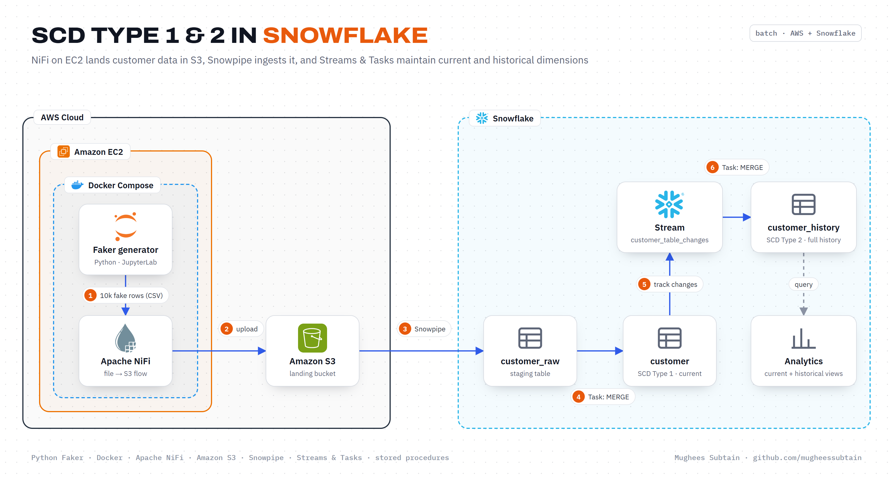
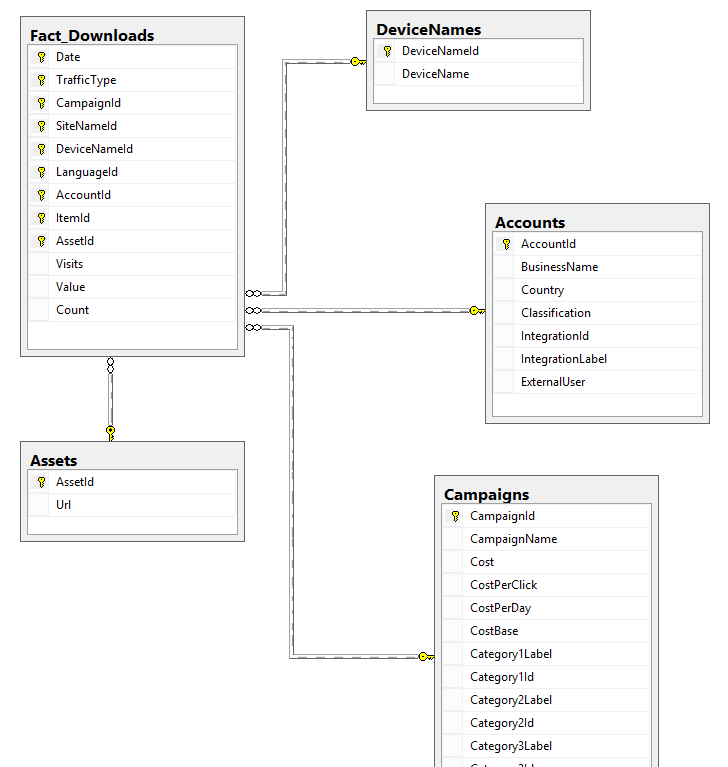

<div align="center">

# Slowly Changing Dimensions in Snowflake

**An automated pipeline that lands customer data from S3 into Snowflake with Snowpipe and keeps SCD Type 1 and Type 2 tables in sync using Streams & Tasks.**


</div>



## Overview

Customer attributes such as email or address change over time. Analysts need both the latest values and the full history of what changed and when. This project automates both:

- **Python Faker** generates realistic customer records, running in JupyterLab inside Docker on an **EC2** instance.
- **Apache NiFi**, in the same Docker Compose stack, picks up the files and uploads them to **Amazon S3**.
- **Snowpipe** auto-ingests new files from an external stage into a staging table.
- A scheduled **Task** calls a stored procedure that merges staging into `customer` (**SCD Type 1**, latest values only).
- A **Stream** captures every insert, update and delete on `customer`.
- A second **Task** merges those changes into `customer_history` (**SCD Type 2**) with `start_time`, `end_time` and `is_current`.

## How it works

| Step | What happens | Where |
|:---:|---|---|
| 1 | Generate 10,000 fake customer rows to a timestamped CSV | `faker.ipynb` in JupyterLab |
| 2 | Upload the CSV files to the S3 landing bucket | Apache NiFi |
| 3 | Auto-ingest new files from the external stage into `customer_raw` | Snowpipe, `sql/02 data_ingestion.sql` |
| 4 | Every minute, `tsk_scd_raw` calls `pdr_scd_demo()` to MERGE `customer_raw` into `customer` and truncate staging | `sql/03 scd_type-1.sql` |
| 5 | `customer_table_changes` records each change made to `customer` | Snowflake Stream |
| 6 | Every minute, `tsk_scd_hist` merges the view `v_customer_change_data` into `customer_history` | `sql/04 scd_type-2.sql` |

### SCD logic

| Change in `customer` | Effect on `customer_history` |
|---|---|
| New customer | Insert a row with `is_current = TRUE` and `end_time = 9999-12-31` |
| Updated customer | Close the current row (`end_time` stamped, `is_current = FALSE`) and insert the new version |
| Deleted customer | Close the current row; no new version is inserted (logical delete) |



## Tech stack

| Layer | Technology |
|---|---|
| Infrastructure | Amazon EC2, Docker Compose |
| Data generation | Python, Faker, JupyterLab |
| Extraction | Apache NiFi 1.14 (with ZooKeeper) |
| Landing | Amazon S3 |
| Warehouse | Snowflake: external stage, Snowpipe, Streams, Tasks, stored procedures, views |

## Project structure

```
.
├── docker_exp/
│   ├── docker-compose.yml     # JupyterLab, ZooKeeper and NiFi
│   └── docker-commands.txt    # Docker install notes for EC2
├── docs/
│   ├── architecture.png
│   └── setup.md               # EC2, Docker and NiFi setup guide
├── images/                    # concept diagrams used in the notebook
├── sql/
│   ├── 01 table_creation.sql  # warehouse, database, tables, stream
│   ├── 02 data_ingestion.sql  # external stage and Snowpipe
│   ├── 03 scd_type-1.sql      # MERGE, stored procedure, scheduled task
│   └── 04 scd_type-2.sql      # change-data view and history task
├── faker.ipynb                # test data generator
├── presentation.ipynb         # walkthrough of the concepts and setup
└── requirements.txt
```

## Getting started

### Prerequisites

- An AWS account with an EC2 instance and an S3 bucket
- A Snowflake account with the `SYSADMIN`, `SECURITYADMIN` and `ACCOUNTADMIN` roles available
- An IAM access key with read access to the bucket

### 1. Start the tools on EC2

Follow [docs/setup.md](docs/setup.md) to install Docker, start JupyterLab and NiFi, generate data and push it to S3.

### 2. Build the Snowflake objects

Run the SQL scripts in order in a Snowflake worksheet:

1. `sql/01 table_creation.sql` creates the `scd_demo.scd2` schema, the `customer`, `customer_raw` and `customer_history` tables, and the stream.
2. `sql/02 data_ingestion.sql` creates the external stage and Snowpipe. Replace the bucket URL and the `<access-key>` / `<secret-key>` placeholders with your own values. Never commit real keys.
3. `sql/03 scd_type-1.sql` creates the MERGE procedure, the `TASKADMIN` role and the `tsk_scd_raw` task.
4. `sql/04 scd_type-2.sql` creates the change-data view and the `tsk_scd_hist` task.

### 3. Run it

```sql
alter task tsk_scd_raw resume;
alter task tsk_scd_hist resume;

-- after a minute
select * from customer_history where is_current = true;
select * from customer_history where is_current = false;
```

Suspend both tasks when you're done so the warehouse doesn't keep running.

## Outcome

- Ingestion and both SCD merges run on schedule with no manual steps, reducing manual intervention by about 70%.
- Every customer change is preserved with validity timestamps, so reports can show the state of any record at any point in time.

## Possible improvements

- Replace the access keys in the stage with a Snowflake storage integration and an IAM role.
- Trigger the merge tasks only when the stream has data (`WHEN SYSTEM$STREAM_HAS_DATA(...)`) instead of every minute.
- Load files by pattern instead of a single file name, so every new file is picked up automatically.

## Author

**Mughees Subtain**, Data Engineer
[GitHub](https://github.com/mugheessubtain) · [LinkedIn](https://www.linkedin.com/in/mughees-subtain-17aab72ba/)
